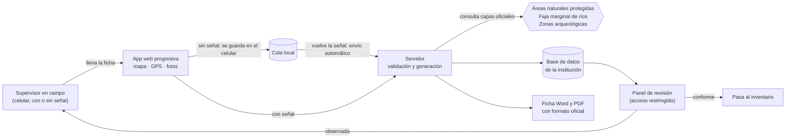

# Caso de estudio · Fichas de campo digitales para la supervisión ambiental

> **Qué es este repositorio:** la explicación del problema, la solución y los resultados de un sistema que construí como practicante en una entidad pública de fiscalización ambiental del Perú.
> **Qué no es:** el código. El software pertenece a la institución y trabaja con su información, así que no se publica. Aquí no hay datos reales: los ejemplos y cifras de muestra son ilustrativos, salvo los resultados agregados de la sección «Resultados».

---

## El problema

Había que actualizar el inventario nacional de áreas degradadas por residuos sólidos:

| Inventario | Áreas por actualizar |
|---|---|
| Anexo I · residuos sólidos municipales | 1 080 |
| Anexo II · residuos de construcción y demolición | 1 130 |

Los supervisores de campo llenaban las fichas **a mano**. Después, otro equipo las digitaba y una revisora comparaba cada ficha con el inventario, el mapa y las capas de áreas protegidas, ríos y zonas arqueológicas. **Revisar una ficha tomaba alrededor de 1 hora.** Muchas zonas no tienen señal, y los errores de coordenadas se descubrían recién en la oficina.

## La solución

Dos **apps web progresivas (PWA)**, una por tipo de ficha, y un **panel de revisión**.

**En el campo**
- Funciona en el celular **sin internet**: la ficha queda en cola y se envía sola cuando vuelve la señal.
- Mapa con GPS y dibujo del área por sectores; fotos y documentos adjuntos.
- **Validación en tiempo real** de las coordenadas contra capas oficiales: áreas naturales protegidas, faja marginal de ríos y zonas arqueológicas. Si el área cae en una de ellas, o si no coincide con lo registrado en el inventario, se genera una alerta.

**En la oficina**
- Cada ficha genera automáticamente su **Word y PDF** con el formato oficial.
- Un **panel web con acceso restringido** muestra el estado de cada ficha (pendiente, en revisión, observada, conforme) y las alertas ya calculadas.
- Si la revisora observa una ficha, el supervisor la corrige y la **reenvía desde su app**.
- **Medición integrada:** se registra cuánto tarda cada etapa (llenado, envío, recepción, revisión) para detectar cuellos de botella.

## Resultados

Primeras semanas de uso real (noviembre de 2026):

| Indicador | Valor |
|---|---|
| Fichas recibidas | más de 230 (205 del Anexo I y 32 del Anexo II) |
| **Tiempo de revisión por ficha** | **de ~1 hora a una mediana de 5 minutos (‑92 %)** |
| Revisión de una ficha conforme | mediana de 1 minuto |
| Revisión de una ficha observada | mediana de 15 minutos, porque requiere redactar la observación |
| Llenado en campo (uso activo) | mediana de 8,5 minutos (Anexo I, 168 fichas) |
| Envío hasta el servidor | mediana de 78 segundos; el 83 % llega en menos de 5 minutos |
| Digitación manual | eliminada: se evitó contratar a unas 10 personas para sistematizar |

> La medición de la revisión empezó el 12 de noviembre de 2026, con una muestra todavía pequeña.

## Cómo trabajé

1. **Requerimientos:** levanté las reglas con los supervisores, la revisora y la coordinación. Las reglas las definí yo; no las inventó la IA.
2. **Construcción con IA:** usé Claude para escribir gran parte del código, por iteraciones y módulo por módulo.
3. **Verificación:** no me quedé con lo que decía la IA.
   - Revisé el código con agentes de IA separados.
   - Corrí pruebas simuladas con datos correctos y con errores a propósito.
   - Confirmé que cada alerta saltara cuando debía, con puntos dentro y fuera de cada capa.
4. **Piloto:** el equipo de inventarios lo probó antes de liberarlo a los supervisores.
5. **Despliegue por versiones,** con una guía de instalación y un registro de cambios en cada entrega.
6. **Mejora continua:** la medición de tiempos mostró, por ejemplo, fichas abiertas muchas veces antes de marcarse. Ese hallazgo se convierte en la siguiente mejora del panel.

## Tecnologías

Google Apps Script · JavaScript · HTML/CSS · apps web progresivas (service worker e IndexedDB para el modo sin conexión) · Leaflet (mapas) · Cloudflare Pages · plantillas Word/PDF · Google Workspace

---

Hecho por [Leonardo Vélez De Villa](https://github.com/leonardovelezdevilla) · Ingeniería Industrial, UNFV
